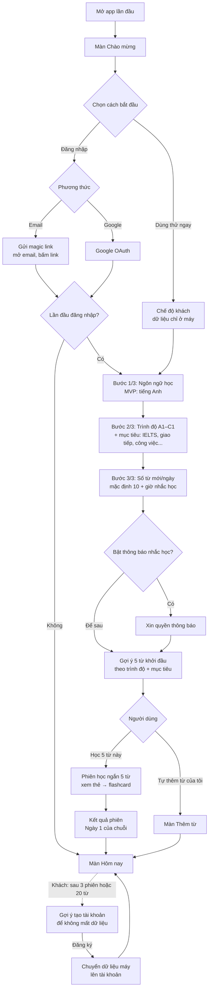
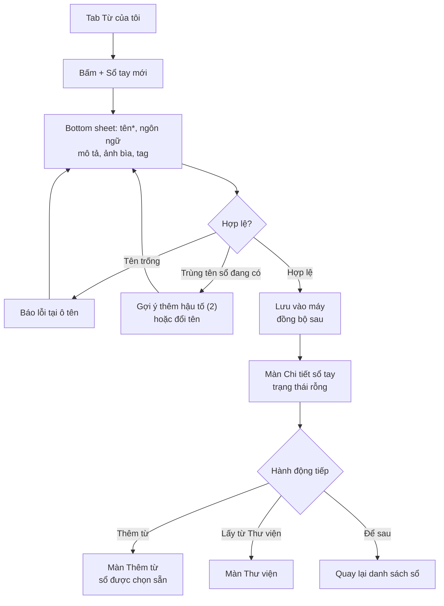
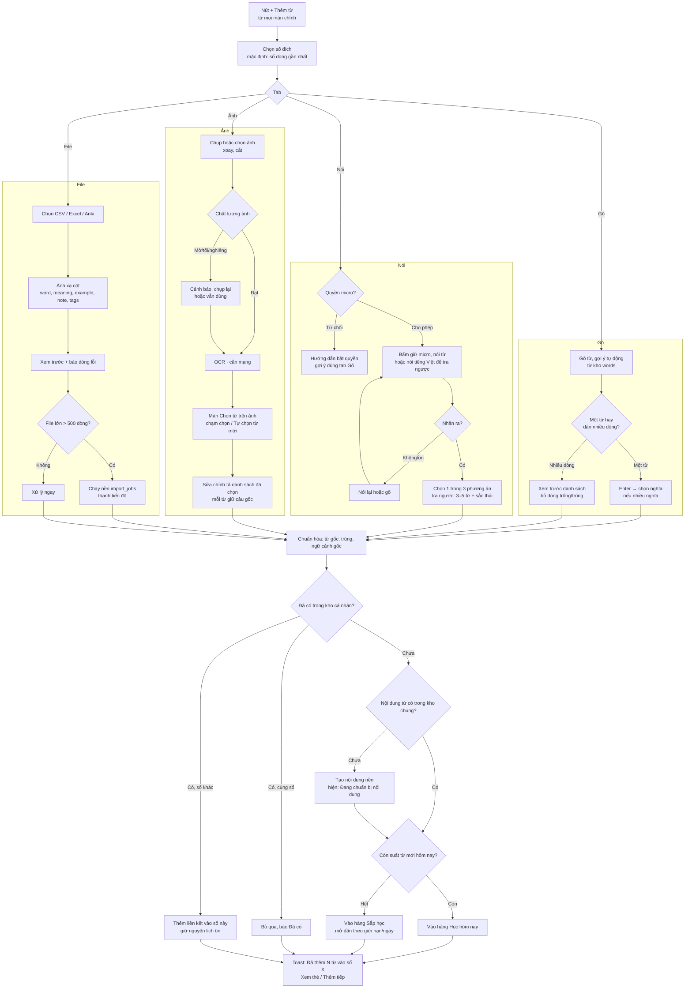
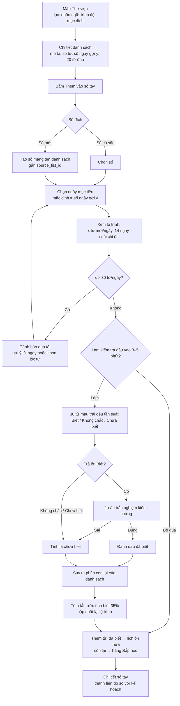
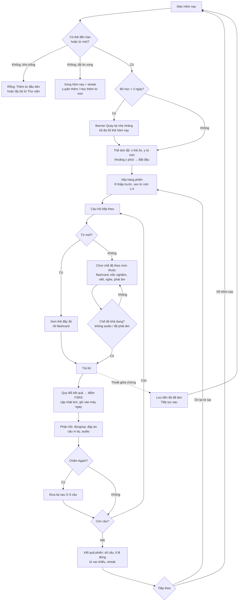
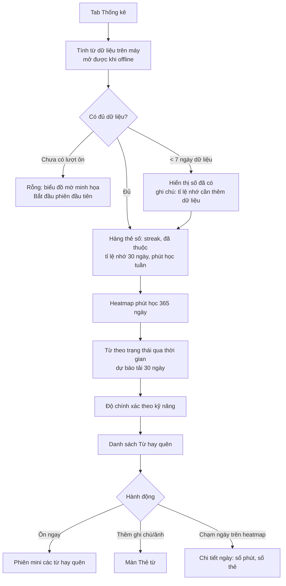
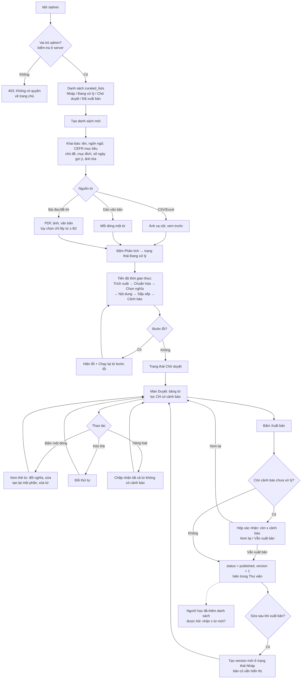

# WordWise – Luồng người dùng và danh sách màn hình

Phiên bản: GĐ0 · Prompt 0.1 · 2026-10-20
Tham chiếu: [docs/plan.md](plan.md) (mục trong ngoặc, vd §2.2, là mục của Kế hoạch).

Đối tượng chính đã chốt: **người tự học**. Các nhóm khác vẫn được phục vụ,
nhưng khi có xung đột ưu tiên thì chọn theo người tự học.

---

## 1. User story

Ký hiệu ưu tiên: **P0** bắt buộc cho MVP · **P1** nên có trong MVP · **P2** sau MVP.

### 1.1 Người tự học (nhóm chính)

Hình mẫu: Minh, 27 tuổi, tự học tiếng Anh bằng sách, podcast, phim; học
không đều, khi hăng hái thì nhập nhiều, bận thì bỏ vài ngày.

| # | User story | Ưu tiên | Mục kế hoạch |
| --- | --- | --- | --- |
| T1 | Là người tự học, tôi muốn gom từ gặp ở nhiều nguồn vào các sổ tay riêng theo chủ đề, để không phải dùng nhiều công cụ. | P0 | §2.2 |
| T2 | Là người tự học, tôi muốn mỗi ngày mở app là biết ngay hôm nay cần ôn bao nhiêu từ và mất khoảng bao lâu, để học đều mà không phải tự lên kế hoạch. | P0 | §2.3, §3 |
| T3 | Là người tự học, tôi muốn sau khi bỏ học vài ngày, app không dồn cho tôi hàng trăm thẻ, để tôi dám quay lại. | P0 | §3.4, §8.3 |
| T4 | Là người tự học, tôi muốn ôn bằng nhiều cách (viết, nghe, nói) tùy mức thuộc, để nhớ sâu và không chán. | P0 | §3.2 |
| T5 | Là người tự học, tôi muốn thấy chuỗi ngày học, số từ đã thuộc và từ hay quên, để biết mình tiến bộ và cần tập trung vào đâu. | P1 | §2.4 |

### 1.2 Người đi làm

Hình mẫu: Lan, 32 tuổi, nhân viên marketing, gặp từ mới khi đọc email,
báo cáo, tài liệu; chỉ có 10–15 phút rảnh trên xe buýt.

| # | User story | Ưu tiên | Mục kế hoạch |
| --- | --- | --- | --- |
| W1 | Là người đi làm, tôi muốn chụp ảnh trang tài liệu rồi chạm vào từ lạ để lưu, để không phải gõ lại. | P0 | §2.2 |
| W2 | Là người đi làm, tôi muốn câu gốc nơi tôi gặp từ được giữ lại trên thẻ, để nhớ từ trong đúng ngữ cảnh công việc. | P0 | §2.2, §3.4 |
| W3 | Là người đi làm, tôi muốn nói nhanh một từ vào điện thoại để lưu khi tay đang bận, để không quên từ trước khi kịp ghi. | P1 | §2.2 |
| W4 | Là người đi làm, tôi muốn ôn được khi không có mạng (tàu điện, máy bay), để tận dụng thời gian chết. | P0 | §4 |
| W5 | Là người đi làm, tôi muốn biết collocation và mức trang trọng của từ, để dùng đúng khi viết email. | P1 | §2.1 |

### 1.3 Người ôn thi

Hình mẫu: Huy, 20 tuổi, sinh viên, thi IELTS sau 60 ngày, cần học hết
một danh sách có sẵn đúng hạn.

| # | User story | Ưu tiên | Mục kế hoạch |
| --- | --- | --- | --- |
| E1 | Là người ôn thi, tôi muốn thêm nguyên bộ "IELTS – Environment" từ Thư viện vào sổ tay, để không phải tự soạn danh sách. | P0 | §2.5 |
| E2 | Là người ôn thi, tôi muốn đặt ngày thi và được chia số từ mới mỗi ngày, để học hết trước ngày thi và còn thời gian ôn lại. | P1 | §3.4 |
| E3 | Là người ôn thi, tôi muốn làm bài kiểm tra ngắn để bỏ qua từ đã biết, để không mất thời gian học lại. | P1 | §9 |
| E4 | Là người ôn thi, tôi muốn nhập file Excel/Anki từ vựng tôi đã có, để không mất công sức đã bỏ ra. | P0 | §2.2 |
| E5 | Là người ôn thi, tôi muốn tập phát âm và nhận điểm theo từng âm, để chuẩn bị cho phần Speaking. | P1 | §2.3 |

### 1.4 Admin nội dung

Hình mẫu: chị Thảo, biên tập nội dung, chuẩn bị 2–3 danh sách/tuần, làm
trên máy tính.

| # | User story | Ưu tiên | Mục kế hoạch |
| --- | --- | --- | --- |
| A1 | Là Admin, tôi muốn tải lên danh sách từ hoặc một bài đọc, để hệ thống tự trích từ và chuẩn bị nội dung thay tôi. | P0 | §2.5 |
| A2 | Là Admin, tôi muốn xem tiến độ phân tích theo thời gian thực và chạy lại từ bước lỗi, để không phải làm lại từ đầu. | P0 | §2.5 |
| A3 | Là Admin, tôi muốn lọc nhanh các từ có cảnh báo (sai chính tả, nhiều nghĩa, vượt trình độ), để chỉ tập trung sửa phần cần sửa. | P0 | §2.5 |
| A4 | Là Admin, tôi muốn xuất bản và sửa danh sách theo phiên bản, để người học không bị xáo trộn khi tôi cập nhật. | P0 | §2.5 |
| A5 | Là Admin, tôi muốn xem số người học, tỉ lệ thuộc và 10 từ khó nhất của mỗi danh sách, để cải thiện danh sách lần sau. | P1 | §2.5 |

---

## 2. Luồng người dùng

Quy ước chung cho mọi luồng:

- Mọi thao tác ghi vào máy trước (IndexedDB), đồng bộ sau; luồng không bị
  chặn khi mất mạng, trừ các bước cần máy chủ (OCR, tạo nội dung mới,
  chấm phát âm), khi đó hiển thị rõ "cần kết nối mạng".
- Mọi cách thêm từ đi qua cùng bước **Chuẩn hóa** (`normalizeEntry`): đưa
  về từ gốc, phát hiện trùng, giữ ngữ cảnh gốc.

### 2.1 Onboarding

Mục tiêu: người mới trải nghiệm một phiên học thật trong ≤ 2 phút, không
bắt buộc tạo tài khoản.

Ghi chú:
- Mỗi bước onboarding có nút "Bỏ qua" (dùng giá trị mặc định), đổi lại
  được trong Cài đặt.
- Khi chuyển dữ liệu khách lên tài khoản đã có dữ liệu: gộp, không ghi đè;
  từ trùng thì giữ lịch ôn có `last_review` mới nhất.

### 2.2 Tạo sổ tay

Ghi chú: lần đầu dùng app, hệ thống tự tạo sổ "Sổ của tôi" để người dùng
thêm từ ngay mà không phải tạo sổ trước.

### 2.3 Thêm từ (Gõ / Nói / Ảnh / File)

Ghi chú:
- Mục tiêu §8.1: thêm một từ đã có trong kho chung **< 10 giây** (Gõ: 3
  chạm; Nói: 2 chạm).
- Thêm hàng loạt (dán nhiều dòng, ảnh, file) luôn hiện tóm tắt trước khi
  lưu: "32 từ: 20 vào Sắp học, 10 học hôm nay, 2 trùng bỏ qua".
- Tạo nội dung chạy nền; người dùng không phải chờ. Thẻ hiện skeleton và
  điền dần từng lớp khi có.

### 2.4 Thêm từ từ danh sách có chủ đích

Ghi chú: người dùng có thể "Chọn lọc" (bỏ tích từng từ) thay vì thêm toàn
bộ, ngay ở màn Chi tiết danh sách.

### 2.5 Phiên "Ôn hôm nay"

Ghi chú:
- Tạm dừng/thoát giữa chừng không mất kết quả: mỗi câu đã ghi vào máy ngay.
- Trong phiên có nút "Tắt phát âm" (nơi công cộng) và "Tắt âm thanh".
- Màn Luyện tập (luyện thêm theo sổ/chủ đề/chế độ) dùng chung luồng từ
  bước "Xếp hàng phiên"; lượt luyện thêm ghi `is_extra=true`.

### 2.6 Xem thống kê

### 2.7 Admin: tải lên → duyệt → xuất bản

---

## 3. Danh sách màn hình (14 màn)

Khung điều hướng người học (mobile): thanh dưới 4 tab **Hôm nay · Từ của
tôi · Luyện tập · Thống kê**; nút tròn **+ Thêm từ** nổi ở góc phải dưới
trên 3 tab đầu; Cài đặt mở từ ảnh đại diện ở góc trên. Biểu tượng trạng
thái đồng bộ (đã đồng bộ / đang đồng bộ / offline) cạnh ảnh đại diện.

Khu Admin (desktop 1280px): thanh bên trái, không dùng thanh dưới.

| # | Màn | Route dự kiến | Tab | Wireframe (0.2) |
| --- | --- | --- | --- | --- |
| 1 | Chào mừng & Onboarding | `/welcome`, `/onboarding` | — | — (đơn giản, mô tả ở đây) |
| 2 | Hôm nay | `/` | Hôm nay | có |
| 3 | Từ của tôi (danh sách sổ tay) | `/notebooks` | Từ của tôi | có |
| 4 | Chi tiết sổ tay | `/notebooks/[id]` | Từ của tôi | có |
| 5 | Thẻ từ | `/words/[id]` | — | có |
| 6 | Thêm từ | `/add` | — | có |
| 7 | Chọn từ trên ảnh | `/add/photo` | — | có |
| 8 | Thư viện | `/library`, `/library/[id]` | Từ của tôi | có |
| 9 | Luyện tập | `/practice` | Luyện tập | — (gộp vào wireframe Phiên ôn) |
| 10 | Phiên ôn (gồm trạng thái cuối Kết quả phiên) | `/review/session` | — | có: 5 chế độ + file riêng cho Kết quả phiên |
| 11 | Thống kê | `/stats` | Thống kê | có |
| 12 | Cài đặt | `/settings` | — | có |
| 13 | Admin: Danh sách & Tải lên | `/admin`, `/admin/lists/new` | — | có |
| 14 | Admin: Duyệt & Xuất bản | `/admin/lists/[id]/review` | — | có |

Kết quả phiên không tính là màn riêng vì cùng route và là bước cuối của
Phiên ôn; wireframe vẫn tách file để dễ duyệt.

Quy ước trạng thái chung (áp dụng cho mọi màn, không lặp lại bên dưới):
- **Đang tải**: skeleton đúng bố cục, không dùng spinner toàn màn hình.
- **Offline**: dữ liệu trên máy vẫn hiển thị; nút cần mạng bị mờ kèm
  "Cần kết nối mạng".
- **Lỗi đồng bộ**: biểu tượng đồng bộ đổi màu cam, chạm để xem chi tiết và
  Thử lại; không chặn thao tác.

### 3.1 Chào mừng & Onboarding

- **Mục đích**: người mới vào học được ngay, ≤ 2 phút tới phiên đầu tiên.
- **Thành phần**: logo + 1 câu giá trị; nút "Dùng thử ngay", "Đăng nhập";
  3 bước có thanh tiến độ (ngôn ngữ, trình độ + mục tiêu, số từ/ngày + giờ
  nhắc); thẻ gợi ý 5 từ khởi đầu.
- **Hành động chính**: Dùng thử ngay → 3 bước → Học 5 từ này.
- **Rỗng**: không áp dụng.
- **Lỗi**: magic link hết hạn → "Link đã hết hạn, gửi lại"; Google OAuth
  bị hủy → quay về màn chọn cách đăng nhập.
- **Đang tải**: "Đang gửi email…" trên nút; sau khi gửi hiện "Kiểm tra hộp
  thư" + nút Gửi lại (khóa 60 giây).

### 3.2 Hôm nay

- **Mục đích**: trả lời "hôm nay tôi cần làm gì" trong 1 giây.
- **Thành phần**: lời chào + streak (ngọn lửa + số ngày); thẻ lớn "Ôn hôm
  nay": số thẻ ôn, số từ mới, thời gian ước tính, nút **Bắt đầu**; dòng
  "Sắp học: x từ đang chờ"; thẻ "Tiếp tục phiên dở" (nếu có); thanh tiến
  độ sổ tay có thời hạn (vd "IELTS Environment: đúng hạn"); 3 từ thêm gần
  đây.
- **Hành động chính**: Bắt đầu phiên ôn.
- **Rỗng**: kho trống → minh họa + "Thêm từ đầu tiên" và "Chọn bộ từ có
  sẵn"; đã ôn xong → "Xong hôm nay!" + streak + "Luyện thêm" / "Học thêm 5
  từ mới".
- **Lỗi**: không đọc được dữ liệu máy → "Không tải được dữ liệu, thử lại".
- **Đang tải**: skeleton thẻ Ôn hôm nay.

### 3.3 Từ của tôi (danh sách sổ tay)

- **Mục đích**: xem và quản lý các sổ tay.
- **Thành phần**: ô tìm từ trong toàn bộ kho; lưới/danh sách sổ (ảnh bìa,
  tên, số từ, số từ đến hạn); thẻ "Thư viện – bộ từ có sẵn"; nút "+ Sổ tay
  mới"; mục "Đã lưu trữ" thu gọn.
- **Hành động chính**: mở sổ; tạo sổ mới.
- **Rỗng**: chỉ có "Sổ của tôi" trống → gợi ý thêm từ hoặc vào Thư viện.
- **Lỗi**: tạo sổ thất bại (hiếm, chỉ khi lỗi ghi máy) → toast + thử lại.
- **Đang tải**: skeleton 4 thẻ sổ.

### 3.4 Chi tiết sổ tay

- **Mục đích**: xem từ trong một sổ, theo dõi tiến độ, thao tác hàng loạt.
- **Thành phần**: đầu trang (ảnh bìa, tên, mô tả, tag, nút Ôn sổ này); với
  sổ từ danh sách có hạn: thanh "Tiến độ so với kế hoạch" (đúng hạn / chậm
  x từ); bộ lọc chip: trạng thái học (Sắp học / Đang học / Đã thuộc / Thành
  thạo), tag, cách nhập; danh sách từ (từ, nghĩa, mức thuộc 0–4 bằng chấm,
  biểu tượng cách nhập); chế độ chọn nhiều: chuyển/sao chép sang sổ khác,
  xóa khỏi sổ, tạm ngưng; menu sổ: sửa, xuất CSV/Anki, lưu trữ, xóa.
- **Hành động chính**: Ôn sổ này; mở thẻ từ; Thêm từ (sổ được chọn sẵn).
- **Rỗng**: "Sổ chưa có từ nào" + 2 nút Thêm từ / Lấy từ Thư viện; lọc không
  ra kết quả → "Không có từ phù hợp, bỏ lọc".
- **Lỗi**: xóa từ khỏi sổ → xác nhận rõ "Từ vẫn còn trong sổ B nên lịch ôn
  được giữ" hoặc "Đây là sổ cuối chứa từ này, lịch ôn sẽ bị xóa"; có Hoàn
  tác 5 giây.
- **Đang tải**: skeleton danh sách; sổ > 200 từ tải cuộn dần.

### 3.5 Thẻ từ

- **Mục đích**: học và tra một từ với đầy đủ nội dung; thêm nội dung riêng.
- **Thành phần**: đầu thẻ (từ, loại từ, IPA US/UK + nút nghe, CEFR, ảnh gợi
  nhớ, chip các sổ chứa từ, dạng từ như more/most resilient); thanh 5 tab
  chia đều: Nghĩa · Ví dụ · Cách dùng (collocations, thành ngữ, lỗi hay gặp) ·
  Từ liên quan · Ghi nhớ (mẹo nhớ, từ dễ nhầm, nguồn gốc) (ẩn tab rỗng); câu gốc người dùng gặp ở đầu tab Ví dụ,
  kèm ảnh gốc nếu có; câu ví dụ tô đậm từ khóa, nút nghe, hiện/ẩn bản dịch;
  chip từ liên quan (chạm: mở thẻ hoặc "+ Thêm vào sổ"); nhãn "Của bạn" cho
  nội dung tự thêm; nút "+ Thêm của bạn" mỗi tab; nút "Báo lỗi" mỗi mục
  gốc; nút đổi nghĩa/ảnh hiển thị + "Dùng lại bản gốc"; công tắc Xem nhanh
  (chỉ tab Nghĩa) / Xem đầy đủ.
- **Hành động chính**: nghe phát âm; thêm vào sổ (nếu chưa có); thêm nội
  dung riêng.
- **Rỗng**: lớp không có nội dung gốc → tab ẩn; lớp chỉ có nội dung của
  người dùng → vẫn hiện.
- **Lỗi**: tạo nội dung thất bại → "Chưa tạo được nội dung, sẽ tự thử lại"
  (không hiện lỗi kỹ thuật); audio lỗi → tự chuyển giọng đọc của trình
  duyệt.
- **Đang tải**: "Đang chuẩn bị nội dung" + skeleton từng tab, tab nào xong
  hiện tab đó.

### 3.6 Thêm từ

- **Mục đích**: thêm từ nhanh bằng 4 cách.
- **Thành phần**: chọn sổ đích (dropdown, mặc định sổ gần nhất); tab
  **Gõ · Nói · Ảnh · File**; dòng phụ "Hoặc lấy từ Thư viện".
  - Gõ: ô nhập lớn tự focus, gợi ý dưới ô (từ + nghĩa ngắn), chọn nghĩa
    nếu nhiều nghĩa, ô "Câu bạn gặp từ này" (tùy chọn); dán nhiều dòng →
    xem trước danh sách.
  - Nói: nút micro lớn bấm giữ, công tắc "Nói tiếng Việt để tra ngược",
    công tắc "Nói liên tục"; 3 phương án dạng thẻ chọn.
  - Ảnh: nút Chụp ảnh / Chọn từ thư viện ảnh; gợi ý chụp rõ, đủ sáng.
  - File: vùng chọn file (CSV, XLSX, APKG), bảng ánh xạ cột, bảng xem
    trước có tô đỏ dòng lỗi, thanh tiến độ cho file lớn.
  - Thanh tóm tắt dưới cùng: "x từ sẽ thêm (y vào Sắp học, z trùng)" + nút
    **Thêm**.
- **Hành động chính**: Thêm.
- **Rỗng**: Gõ chưa có gợi ý → "Không tìm thấy trong kho, vẫn thêm 'xyz'?"
  (tạo nội dung mới).
- **Lỗi**: từ chối micro (hướng dẫn bật); trình duyệt không hỗ trợ nhận
  dạng giọng nói (tự chuyển sang thu âm gửi máy chủ); không nhận ra giọng
  nói; file sai định dạng / quá lớn (> 10 MB); vượt 50 từ mới cần tạo nội
  dung/ngày → từ vẫn được lưu, nội dung tạo vào hôm sau.
- **Đang tải**: nút Thêm hiện "Đang thêm…"; file lớn có thanh tiến độ và
  cho rời màn (chạy nền, báo khi xong).

### 3.7 Chọn từ trên ảnh

- **Mục đích**: chọn từ cần học trực tiếp trên ảnh đã chụp.
- **Thành phần**: ảnh phóng to/thu nhỏ được, khung quanh từng từ nhận
  dạng; từ đã có trong kho có khung xám; chạm chọn/bỏ chọn (khung xanh),
  kéo để chọn cụm từ; nút "Tự chọn từ mới"; ngăn kéo dưới hiện danh sách
  đã chọn (sửa chính tả, xem câu gốc); công tắc "Giữ ảnh làm ngữ cảnh"
  (mặc định tắt); nút **Thêm x từ**.
- **Hành động chính**: chọn từ → Thêm.
- **Rỗng**: không nhận ra chữ → "Không tìm thấy chữ trên ảnh, chụp lại gần
  hơn"; Tự chọn không ra từ nào → "Bạn đã biết hết các từ trên ảnh".
- **Lỗi**: mất mạng khi OCR → giữ ảnh, "Thử lại khi có mạng"; vượt 30
  ảnh/ngày → thông báo giới hạn, mở lại ngày mai.
- **Đang tải**: ảnh hiện mờ + "Đang đọc chữ…" (thường 2–4 giây).

### 3.8 Thư viện

- **Mục đích**: tìm và thêm bộ từ có chủ đích vào sổ tay.
- **Thành phần**: chip lọc ngôn ngữ, trình độ, mục đích (IELTS, TOEIC, giao
  tiếp, công việc…); thẻ danh sách (ảnh bìa, tên, số từ, CEFR, số ngày gợi
  ý, số người học). Chi tiết danh sách: mô tả, các chủ đề con, xem trước 20
  từ đầu, nút **Thêm vào sổ tay**, "Chọn lọc từ". Luồng thêm (bottom sheet
  nhiều bước): chọn sổ → ngày mục tiêu + lộ trình → kiểm tra đầu vào (thẻ
  từ lớn, 3 nút Biết / Không chắc / Chưa biết, thanh tiến độ 30 câu) → tóm
  tắt.
- **Hành động chính**: Thêm vào sổ tay.
- **Rỗng**: không có danh sách khớp bộ lọc → "Bỏ bớt bộ lọc"; Thư viện chưa
  có danh sách nào → "Sắp có, trong lúc chờ hãy tự thêm từ".
- **Lỗi**: danh sách đã có trong sổ → "Bạn đã thêm danh sách này vào sổ X"
  + mở sổ; lộ trình > 30 từ/ngày → cảnh báo vàng.
- **Đang tải**: skeleton thẻ danh sách; offline → chỉ hiện danh sách đã
  xem trước đó.

### 3.9 Luyện tập

- **Mục đích**: luyện thêm theo ý muốn ngoài lịch "Ôn hôm nay".
- **Thành phần**: chọn phạm vi (sổ tay, danh sách, chủ đề, tag, trạng
  thái); chọn chế độ (Trộn tự động hoặc 1 trong 5 chế độ); chọn số câu
  10/20/30; ghi chú nhỏ "Luyện thêm không làm thay đổi lịch ôn, trừ khi
  bạn trả lời sai"; nút **Bắt đầu**.
- **Hành động chính**: Bắt đầu.
- **Rỗng**: phạm vi không có từ → "Phạm vi này chưa có từ"; chế độ không
  khả dụng (vd Nghe khi không có audio) → mờ kèm lý do.
- **Lỗi**: phạm vi có ít hơn số câu → "Chỉ có 6 từ, luyện 6 câu?".
- **Đang tải**: đếm số từ trong phạm vi hiện skeleton nhỏ.

### 3.10 Phiên ôn

- **Mục đích**: ôn từng câu nhanh, tập trung, phản hồi tức thì.
- **Thành phần chung**: thanh tiến độ trên cùng (câu x/y), nút đóng (×),
  menu nhanh (tắt âm thanh, tắt phát âm); vùng câu hỏi; vùng trả lời;
  phản hồi sau khi trả lời (đúng xanh / sai đỏ, đáp án, câu ví dụ, nút
  nghe, nút "Tiếp" hoặc tự chuyển).
  - **Flashcard**: mặt trước từ + audio tự phát (hoặc nghĩa ở chiều
    ngược); chạm/Space lật; 4 nút Quên / Khó / Được / Dễ kèm khoảng cách
    kế tiếp ("10 phút", "1 ngày", "4 ngày", "9 ngày"); vuốt trái = Quên,
    phải = Được.
  - **Trắc nghiệm**: câu hỏi (từ hoặc nghĩa), 4 đáp án dạng nút lớn.
  - **Tập viết**: đề (nghĩa + loại từ, hoặc câu khuyết từ); 4 cấp gợi ý: ô
    chữ xáo trộn → điền chữ khuyết → chữ đầu + số ô → ô trống; nút "Gợi ý"
    (hạ 1 cấp); sau khi trả lời hiện diff từng chữ.
  - **Tập nghe**: nút phát lớn tự phát, nút nghe lại (đếm lần), nút 0.75x;
    3 dạng: chọn nghĩa / gõ lại từ / điền từ vào câu.
  - **Tập phát âm**: từ + IPA, nghe mẫu (thường/chậm), nút thu âm lớn, sóng
    âm khi thu; kết quả: điểm 0–100, IPA tô màu từng âm, mẹo cho âm sai,
    nghe bản thu so với mẫu; ghi chú "điểm chỉ mang tính tham khảo".
- **Hành động chính**: trả lời → Tiếp.
- **Rỗng**: không áp dụng (không vào được phiên khi không có câu).
- **Lỗi**: audio không tải được → bỏ qua chế độ nghe cho thẻ đó, chọn chế
  độ khác; micro bị từ chối / chấm phát âm lỗi → "Bỏ qua câu phát âm" (không
  tính sai); thoát giữa chừng → xác nhận "Kết quả đã lưu, tiếp tục sau".
- **Đang tải**: chuyển câu < 100 ms (tải trước 3 câu kế); chấm phát âm hiện
  "Đang chấm…" (< 3 giây).

#### 3.10b Trạng thái cuối: Kết quả phiên

- **Mục đích**: ghi nhận nỗ lực, cho biết cần chú ý gì, khuyến khích quay
  lại mai.
- **Thành phần**: streak cập nhật (hiệu ứng nhẹ); số câu, tỉ lệ đúng, thời
  gian; số từ lên mức thuộc; danh sách từ sai nhiều (chạm mở thẻ); "Ngày
  mai: khoảng x thẻ"; nút **Xong**, "Ôn lại từ sai", "Học thêm 5 từ mới"
  (nếu còn trong Sắp học).
- **Hành động chính**: Xong.
- **Rỗng**: phiên không sai câu nào → "Không sai câu nào!" thay danh sách.
- **Lỗi**: không áp dụng (dữ liệu đã ghi máy).
- **Đang tải**: không áp dụng.

### 3.11 Thống kê

- **Mục đích**: thấy tiến bộ và điểm yếu.
- **Thành phần**: hàng 4 thẻ số (streak, tổng từ đã thuộc, tỉ lệ nhớ 30
  ngày, phút học tuần này so với tuần trước); heatmap 365 ngày (cuộn ngang
  trên mobile); biểu đồ cột chồng từ theo trạng thái; biểu đồ dự báo tải 30
  ngày; độ chính xác theo kỹ năng (cột ngang); danh sách "Từ hay quên" với
  nút Ôn ngay, Thêm ghi chú/ảnh.
- **Hành động chính**: Ôn ngay các từ hay quên.
- **Rỗng**: chưa có lượt ôn → biểu đồ mờ minh họa + "Hoàn thành phiên đầu
  tiên để thấy tiến bộ"; < 7 ngày → tỉ lệ nhớ hiện "—" kèm "cần thêm dữ
  liệu".
- **Lỗi**: không áp dụng (tính trên máy).
- **Đang tải**: skeleton thẻ số và khung biểu đồ.

### 3.12 Cài đặt

- **Mục đích**: điều chỉnh việc học và quản lý tài khoản.
- **Thành phần**: Tài khoản (tên, email, đăng xuất; với khách: "Tạo tài
  khoản để lưu dữ liệu"); Học tập (ngôn ngữ học, trình độ, mục tiêu, số từ
  mới/ngày, số thẻ ôn tối đa/ngày, tỉ lệ nhớ mong muốn 80–95% kèm ước tính
  số thẻ/ngày); Âm thanh (giọng US/UK, luyện nhiều giọng, tự phát audio);
  Luyện tập (bật/tắt phát âm, phím tắt); Nhắc học (giờ nhắc, bật/tắt; ghi
  chú hạn chế trên iOS); Giao diện (sáng/tối/theo máy); Dữ liệu (xuất
  JSON/CSV, xóa tài khoản); Góp ý; Chính sách quyền riêng tư & ghi nguồn;
  phiên bản app.
- **Hành động chính**: thay đổi cài đặt (tự lưu).
- **Rỗng**: không áp dụng.
- **Lỗi**: trình duyệt chặn thông báo → hướng dẫn bật; xóa tài khoản → xác
  nhận 2 bước (gõ "XÓA").
- **Đang tải**: không áp dụng (đọc từ máy).

### 3.13 Admin: Danh sách & Tải lên (desktop)

- **Mục đích**: quản lý danh sách có chủ đích và tạo danh sách mới.
- **Thành phần**: thanh bên (Danh sách, Báo lỗi nội dung, Thống kê); bảng
  danh sách (tên, trạng thái dạng nhãn màu, số từ, số người học, cập nhật,
  phiên bản); bộ lọc trạng thái; nút **Tạo danh sách**. Form tạo: thông tin
  khai báo; 3 tab nguồn (CSV/Excel có ánh xạ cột, Dán văn bản, Bài đọc/đề
  thi với tùy chọn "chỉ lấy từ ≥ B2"); nút **Phân tích**. Khi Đang xử lý:
  thanh tiến độ 6 bước, số từ đã xong, chi phí token ước tính, nút Chạy lại
  từ bước lỗi.
- **Hành động chính**: Phân tích.
- **Rỗng**: chưa có danh sách → "Tạo danh sách đầu tiên".
- **Lỗi**: không phải admin → 403; file sai định dạng; bước pipeline lỗi
  → hiện bước + thông báo + Chạy lại.
- **Đang tải**: tiến độ thời gian thực; rời trang vẫn chạy nền.

### 3.14 Admin: Duyệt & Xuất bản (desktop)

- **Mục đích**: kiểm tra, sửa và xuất bản kết quả phân tích.
- **Thành phần**: đầu trang (tên, trạng thái, phiên bản, số cảnh báo còn
  lại, nút **Xuất bản**); bộ lọc "Chỉ có cảnh báo", theo chủ đề con, theo
  loại cảnh báo; bảng (thứ tự kéo thả, từ, loại từ, nghĩa đã chọn, CEFR, chủ
  đề con, cảnh báo); khung bên phải khi chọn dòng: thẻ từ 5 tab sửa được, đổi
  nghĩa, Tạo lại lớp này, Xóa khỏi danh sách; thao tác hàng loạt "Chấp nhận
  tất cả không có cảnh báo"; tab Thống kê danh sách (số người học, tỉ lệ
  hoàn thành, tỉ lệ thuộc, 10 từ hay quên).
- **Hành động chính**: sửa cảnh báo → Xuất bản.
- **Rỗng**: không còn cảnh báo → nhãn xanh "Sẵn sàng xuất bản".
- **Lỗi**: lưu sửa thất bại → giữ nội dung đang sửa + Thử lại; xuất bản khi
  còn cảnh báo → hộp xác nhận.
- **Đang tải**: "Tạo lại lớp" hiện skeleton trong khung lớp đó.

---

## 4. Ba điểm dễ khiến người học bỏ cuộc

### 4.1 Nhập quá nhiều từ một lúc

**Hiện tượng**: hăng hái chụp 5 trang sách hoặc nhập file 500 từ → hôm sau
có 200 từ mới + hàng trăm thẻ ôn → choáng, bỏ.

**Thiết kế để tránh**:
- Mọi nhập hàng loạt (dán nhiều dòng, ảnh, file, danh sách Thư viện) vào
  hàng **Sắp học**, mở dần theo giới hạn từ mới/ngày (mặc định 10).
- Màn tóm tắt trước khi lưu nói rõ hệ quả: "120 từ sẽ được mở dần trong
  12 ngày (10 từ/ngày)".
- Không cho tăng giới hạn từ mới/ngày quá 30 mà không có cảnh báo; khi
  tăng, hiện ước tính "khoảng x thẻ ôn/ngày sau 1 tháng".
- "Tự chọn từ mới" trên ảnh lọc sẵn từ đã biết và từ quá dễ, chỉ chọn tối
  đa 15 từ.

### 4.2 Tải ôn dồn sau khi bỏ vài ngày

**Hiện tượng**: bỏ 5 ngày → mở app thấy "214 thẻ đến hạn" → cảm giác nợ
nần, đóng app luôn. Đây là lý do bỏ học phổ biến nhất của ứng dụng SRS.

**Thiết kế để tránh**:
- Chế độ **Quay lại nhẹ nhàng** khi bỏ > 3 ngày: tối đa 50 thẻ/ngày, ưu tiên
  thẻ có khả năng nhớ thấp nhất, phần còn lại dàn đều sang các ngày sau;
  tạm dừng mở từ mới cho đến khi tải về mức bình thường.
- Màn Hôm nay **không hiện tổng số nợ**; chỉ hiện phiên hôm nay ("40 thẻ,
  khoảng 8 phút") và lời chào tích cực ("Chào mừng trở lại!").
- Có nút "Phiên ngắn 5 phút" khi người dùng ít thời gian.
- Streak có "ngày nghỉ" (1 ngày/tuần không làm mất chuỗi) — **cần chốt**,
  xem mục 5.

### 4.3 Phiên đầu tiên trống rỗng, chưa thấy giá trị

**Hiện tượng**: tạo tài khoản → sổ tay trống → phải tự nghĩ từ để thêm →
chưa ôn được gì trong ngày đầu → không có lý do quay lại ngày 2.

**Thiết kế để tránh**:
- Không bắt buộc tài khoản: "Dùng thử ngay".
- Onboarding 3 bước có nút Bỏ qua, kết thúc bằng **5 từ khởi đầu** theo
  trình độ và mục tiêu → học ngay một phiên ngắn → nhận ngày 1 của streak.
- Sổ "Sổ của tôi" tạo sẵn, nút + Thêm từ luôn hiện; thẻ từ có nội dung
  phong phú ngay lập tức (nhờ 3.000 từ tạo sẵn) để người dùng thấy khác
  biệt so với tự ghi chép.
- Kết quả phiên đầu nói rõ lịch tiếp theo: "Ngày mai bạn sẽ ôn lại 5 từ
  này, khoảng 2 phút" + đề nghị bật nhắc học.

---

## 5. Câu hỏi mở (cần chủ sản phẩm chốt, không chặn GĐ0)

1. **Streak có "ngày nghỉ"** (1 ngày/tuần không mất chuỗi)? Đề xuất: **có**,
   giảm áp lực cho người tự học học không đều.
2. **5 từ khởi đầu** lấy từ đâu? Đề xuất: bộ nhỏ do Admin soạn sẵn cho mỗi
   trình độ × mục tiêu (cần có ở GĐ7; trước đó dùng 20 từ seed của GĐ1).
3. **Gợi ý tạo tài khoản cho khách**: sau 3 phiên hoặc 20 từ là hợp lý?
4. **Ngưỡng file lớn chạy nền**: 500 dòng là hợp lý?
